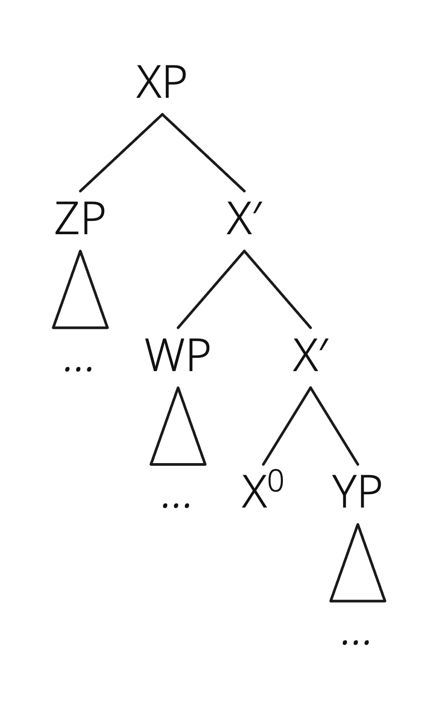
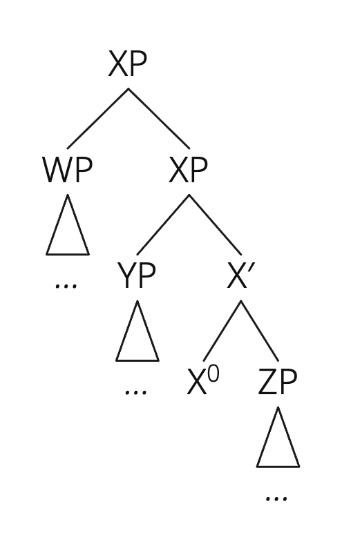
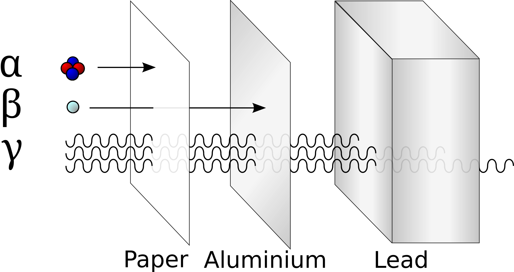

## В прошлый раз

- синтаксические отношения
    - сестринство
    - доминирование
    - с-командование
- роль с-командования для выявления правил употребления местоимений
- ограничения на возможные структуры: тета-критерий
- синтаксис нульместных, одноместных, двухместных и трёхместных глагольных групп
- структура предложения
  - CP > TP > vP > VP

## Сегодня

* неглагольные предикаты и тета-критерий
* ещё об адъюнкции
* синтаксические процессы: передвижение
* порядок слов

# Неглагольные предикаты и тета-критерий

## AP, NP, PP и AdvP как предикаты 

Рассмотрим пару безглагольных предложений:

::: ex
Иванов — врач.\
→ предикатом является N^0^ *врач*
:::

::: ex
Иванов умён.\
→ предикатом является A^0^ *умён*
:::

 

::: ex
Иванов в Москве.\
→ предикатом является P^0^ *в*
:::

::: ex
Иванов наверху/дома.\
→ предикатом является Adv^0^ *наверху/дома*
:::

В логике первого порядка подобные структуры обычно представляются в виде формул следующего вида, где «И» — константа/постоянная величина *Иванов*:

::: ex
*врач*(И)
:::

Регулируются ли структуры такого типа тета-критерием?

## Субъект в целом обязателен^[В нейтральном контексте; возможны в непредикативном употреблении.]

:::: ex
::: exi
\*Врач.
:::
::: exi
\*Умён.
:::
::: exi
\*В Москве. 
:::
::: exi
\*Наверху/дома.
:::
::::

> Гипотеза\
Предложения (а--d) невозможны, т.к. нарушают тета-критерий: единственная тета-роль одноместного предиката остаётся неприсвоенной.

Существуют ли двухместные неглагольные предикаты, для которых также можно было бы показать нарушение тета-критерия?

## Обязательные аргументы прилагательных

Некоторые прилагательные и существительные способны принимать предложные группы в качестве дополнений:

::: ex
Williams is fond [~PP~ of painting ]. 
::: 

:::: {.fragment}

Данные PP-комплементы обязательны:

::: ex
\*Williams is fond.
:::

::::

::::: {.fragment}

Подобные прилагательные существуют и в русском языке.

#### _склонный_

:::: ex
::: exi
Нам нужны склонные к компромиссам сотрудники. 
:::
::: exi
\*Нам нужны склонные сотрудники.
:::
::::

#### _похож_

:::: ex
::: exi
Иванов похож на отца.
:::
::: exi
\*Иванов похож.
:::
::::
:::::

# Ещё об адъюнкции

## Адъюнкция к X′ и XP

:::: {.columns}

::: {style="text-align: center;"}
::: {.column width="33%"}
{.lightbox width=70%}
:::

::: {.column width="33%"}
{.lightbox width=70%}
:::
:::
::::

## Возможные и невозможные структуры

:::: {style="text-align: center;"}
::: {layout-nrow=2}
{#fig-zpxp}

{#fig-zpx}

{#fig-xyz} 

{#fig-xy}

{#fig-xbarybar}

{#fig-ybarxbar}

{#fig-xbaryp}

{#fig-ybar}

{#fig-xbarypspec}

{#fig-xpypzp}

:::
::::

## Cложные вершины

Иногда то, что мы по ряду причин хотим считать вершиной, состоит из нескольких «слов»:

- _англ._ in front of
- *из-за*
- *из-под*

Каждый из этих элементов по отдельности может быть вершиной.

-----------

Предположим, что вершина А может присоединяться в качестве **адъюнкта** к вершине B, образуя вместе с ней **сложную вершину**. 

Например, A = *за*~P~; B = *из*~P~:

::: {style="text-align: center;"}
{.lightbox width=20%}
:::

Сложный предлог *из-за* наследует грамматические свойства *из* и не наследует грамматических свойств *за*:

:::: ex
::: exi
из дом**-а**
:::
::: exi
за дом**-ом**
:::
::: exi
из-за дом**-а**/**-\*ом**
:::
::::

## Сложные вершины и передвижение глагола

Вспомним, что финитный глагол в разных языках может произноситься в разных позициях:

- в v^0^ в русском и английском;
- в T^0^ в романских;
- в C^0^ в остальных германских.

Мы будем считать, что, передвигаясь из V^0^ в v^0^, глагол образует с v^0^ сложную вершину путём адъюнкции.

## V^0^+v^0^ = ? ##

:::: {style="text-align: center;"}

::: {.layout-nrow=2}

{.lightbox width=40% } {.lightbox width=40% }

:::
::::

## Несовпадение позиций ##

Иногда составляющая произносится в одной позиции, а интерпретируется в другой:

  * Spec,vP → Spec,TP
      * *Наши гости уже все ушли.*
      * *John seems to be reading a book.*
  * позиция вопросительных групп в прямых и косвенных вопросах
      * *What book does John seem to be reading \_\_?*
      * *Mary wonders what book John seems to be reading \_\_.*

. . . 

К ним мы добавим пассивизацию, а также т.н. «свободный порядок слов» в русском.

## Свободный порядок слов ##

:::: ex
::: exi
Вчера я положил свою книгу на полку.
:::
::: exi
Я вчера положил свою книгу на полку.
:::
::: exi
На полку я вчера положил свою книгу.
:::
::: exi 
Свою книгу я вчера положил на полку.
:::
::::

### Однако 

:::: ex
::: exi 
\*На я полку книгу вчера положил свою.
:::
::: exi
\*Свою на вчера книгу я полку положил.
:::
::::

→ свободным является не порядок **слов**, а порядок **составляющих**

## Передвижение и X′-схема 

Вспомним, что структуры, создаваемые передвижением, также соблюдают общие принципы построения словосочетаний. 

Следовательно, для каждой рассмотренной «конструкции» 

* нам нужна вершина, инициирующая передвижение;
* группы будут передвигаться в её спецификатор
    * C~[?]~
	* C~[[top]{.smallcaps}]~
	* C~[[foc]{.smallcaps}]~

::: {.callout-important title="Внимание"}
та же логика, что при передвижении подлежащего в Spec,TP
:::

# О существовании передвижения #

## *wanna*-contraction ##

Сравним следующие английские предложения:

:::: ex
::: exi
I want to help you.
:::
::: exi
I wanna help you.
:::
::::
:::: ex
::: exi
Who do you want to help?
:::
::: exi
Who do you wanna help?
:::
::::

---------------

::: ex
Who do you want to help you?
:::

но:

::: ex
\*Who do you wanna help you?
:::

. . . 

След/копия подлежащего блокирует слияние:

::: ex
[~CP~ who do [~TP~ you want [ ~~who~~ [~TP~ to help you]]]]
:::

# Кстати: о бедности стимула #

## Местоимения и усвоение языка [@Leddon:2006] ##

Антецедент рефлексива находится в области ближайшего подлежащего:

:::: ex
::: exi
Norbert remembered that [Ellen]{.c1} painted a picture of [herself]{.c1}.
:::
::: exi
\*[Norbert]{.c3} remembered that Ellen painted a picture of [himself]{.c3}.
:::
::: exi
Norbert remembered that [Ellen]{.c1} was very proud of [herself]{.c1}.
:::
::: exi 
\*[Norbert]{.c3} remembered that Ellen was very proud of [himself]{.c3}.
:::
::::

> Допустим, что ребёнок получает эти данные из языковой среды.

## Дополнительные ограничения ##

Оказывается, что сформулированное ограничение недостаточно строго:

:::: ex
::: exi
Norbert remembered which picture of herself Ellen painted.
:::
::: exi
Norbert remembered which picture of himself Ellen painted.
:::
::: exi 
Norbert remembered how proud of herself Ellen was.
:::
::: exi
\*Norbert remembered how proud of himself Ellen was.
:::
::::

Какие первичные языковые данные необходимы для усвоения данного контраста?

## @Leddon:2006 ##

Структурно близкие предложения не встречаются в речи, направленной на детей:

* 10000 частных вопросов (wh-questions) в базе данных Child Language Data Exchange System (CHILDES)
* **0 вопросов** с вопросительной группой, содержащей рефлексив/личное местоимение/имя
* аналогичный поиск в Гугле выдаёт только ссылки на лингвистические работы

→ отсутствуют данные для формулировки обобщения

## Predicate-internal subject hypothesis ##

Все аргументы получают тета-роли низко.

Ещё раз рассмотрим интересующие нас примеры:

:::: ex
::: exi
Norbert remembered which picture of herself Ellen painted.
:::
::: exi
Norbert remembered which picture of himself Ellen painted.
:::
::: exi 
Norbert remembered how proud of herself Ellen was.
:::
::: exi
\*Norbert remembered how proud of himself Ellen was.
:::
::::

Предположим, что, подобно глагольным группам, предикат *proud of himself/herself* содержит невидимую копию подлежащего:

::: ex
\*Norbert remembered [how ~~Ellen~~ proud of himself] Ellen was.
:::

Определённое сходство с непроизносимым, но грамматически активным глаголом в [~VP~ [~NP~ *a pound*] [~V′~ ~~*give*~~ [~PP~ *to Michael*]]]

# Подробнее о передвижении #

## Свойства передвижения ##

  * передвигаются только целые составляющие
  * результатом передвижения являются структуры, подчиняющиеся правилам теории проекции (X′)
  * передвижение происходит «вверх по дереву»
  * передвижение не добавляет в структуру новых элементов
  * передвижение не может пересекать границ некоторых объектов

## Лингвистические «гамма-лучи»

Давайте рассмотрим одну метафору.

::: {style="text-align: center;"}
{ width=45% }
:::

## Неограниченность вопросительного выноса

Вопросительный вынос может быть локальным, т.е. происходить в пределах одного простого предложения:

::: ex
He was reading **a book**.
:::

::: ex
**What** was he reading \_\_?
:::

## Неограниченность в вопросах

Одна граница клаузы:

::: ex
He said [ (that) he was reading **a book**].
:::

::: ex
**What** did he say [ (that) he was reading \_\_ ]?
:::

-----------------

Две границы клауз:

::: ex
She believes [ (that) he said [ (that) he was reading **a book**].
:::

::: ex
**What** does she believe \
[ (that) he said [ (that) he was reading \_\_ ]]?
:::

-----------------

Три границы клауз:

::: ex
They are claiming [ (that) she believes [ (that) he said [ (that) he was reading **a book**]]].
:::

::: ex
**What** are they claiming [ (that) she believes\
[ (that) he said [ (that) he was reading \_\_ ]]]?
:::

-----------------

Четыре границы клауз:

::: ex
I think [ (that) they are claiming [ (that) she believes\
[ (that) he said [ (that) he was reading **a book**]]]].
:::

::: ex
**What** do you think [ (that) they are claiming [ (that) she believes \ 
[ (that) he said [ (that) he was reading \_\_]]]]?
:::

------------------

Пять границ клауз:

::: ex
Everyone agrees [ (that) I think [ (that) they are claiming [ (that) she believes\
[ (that) he said [ (that) he was reading **a book**]]]]].
:::

::: ex
**What** does everyone agree [ (that) you think [ (that) they are claiming [ (that) she believes \ 
[ (that) he said [ (that) he was reading \_\_]]]]]?
:::

-------------------

Шесть границ клауз:

::: ex
Everyone can hardly deny [ (that) they agree [ (that) I think [ (that) they are claiming [ (that) she believes\
[ (that) he said [ (that) he was reading **a book**]]]]]].
:::

::: ex
**What** can everyone hardly deny [ (that) they agree [ (that) you think [ (that) they are claiming [ (that) she believes \ 
[ (that) he said [ (that) he was reading \_\_]]]]]?
:::

**Вывод:** не существует принципиального верхнего предела числа границ клауз, которые может пересекать вопросительный вынос

## Но!

Иногда вопросы просто кажутся невозможными:

::: ex
He made the claim [ that he has met **Wolverine** ]
:::

::: ex
\***Who** did he make the claim [ that he has met \_\_]?
:::

::: ex
He mentioned the fact [ that he had run into **Magneto** ]
:::

::: ex
\*Who did he mention the fact [ that he had run into \_\_]?
:::

::: {.fragment}

Что особенно поразительно, учитывая полную приемлемость следующего:

::: ex
**Who** did he claim [ that he has met \_\_ ]?
:::

::: ex
**Who** did he mention [ that he had run into \_\_]?
:::

**Что здесь происходит?**
:::

# Синтаксические острова #

## Виды островов ##

Термин впервые употреблён в диссертации @Ross:1967:

- конфигурации, из которых невозможно осуществить синтаксическое передвижение 
- **сильные** и **слабые** острова

## Сильные острова ##

### Ограничение сложной именной группы ###

::: ex
Я видел соседей [которые купили машину]
:::
::: ex
\*Машину я видел соседей [которые купили ~~машину~~]\
(вынос невозможен)
:::

### Ограничение сочинённой структуры ###

::: ex
Они купили [дачу и машину]
:::
::: ex
\*Машину они купили [дачу и ~~машину~~]
:::

Но:

::: ex
Дачу они купили [~~дачу~~ и машину]
:::

**почему так можно?**

## Ограничение сложной именной группы ##

Сложная именная группа — именная группа, осложнённая собственным зависимым предложением —  придаточным относительным либо аргументным.

::: ex
утверждение, которое преподаватель старательно формулировал
:::

::: ex
утверждение, что человек произошёл от обезьяны
:::

Разберёмся, как это работает. 

## Сложные именные группы и диагностика передвижения ##

Создаём базовое предложение с интересующей нас **группой** внутри относительного предложения (остров выделен цветом):

::: ex
Иванов слышал [утверждение, которое **преподаватель** старательно формулировал]{.mark}
:::

А теперь топикализуем интересующую нас группу влево:

::: ex
\*Преподаватель Иванов слышал [утверждение, которое \_\_ старательно формулировал]{.mark}
:::

Топикализация составляющей *преподаватель* изнутри сложной именной группы приводит к неприемлемости.

Следовательно, мы имеем дело с синтаксическим передвижением.

## Сложная именная группа и вопросительный вынос ##

Возьмём тот же пример:

::: ex
Иванов слышал [утверждение, которое **преподаватель** старательно формулировал]{.mark}
:::

Теперь нужно просто задать вопрос к именной группе *преподаватель*:

::: ex
\*Кто Иванов слышал [утверждение, которое \_\_ старательно формулировал]{.mark}?
:::

Вопросительный вынос составляющей *преподаватель* изнутри сложной именной группы приводит к неприемлемости.

Следовательно, мы имеем дело с синтаксическим передвижением.

## Задание ##

Проверьте чувствительность топикализации к ограничению сложной именной группы при помощи сложной именной группы второго типа:

::: ex
утверждение, что человек произошёл от обезьяны
:::

## Задание ##

Проверьте чувствительность вопросительного выноса к ограничению сложной именной группы при помощи сложной именной группы второго типа:

::: ex
утверждение, что человек произошёл от обезьяны
:::

## Остров подлежащего и вопросительный вынос ##

Подлежащие занимают позицию спецификатора в структуре X′.

::: ex
[Книга профессора **о деепричастиях**]{.mark} пользовалась популярностью.
:::

Зададим вопрос о содержании книги:

::: ex
\*О чём [книга профессора \_\_]{.mark} пользовалась популярностью?
::: 

Но как отличить это от ситуаций, когда передвижение происходит внутри границ острова и ограничение сложной именной группы не нарушается?

::: ex
[О чём книга профессора \_\_]{.mark} пользовалась популярностью?
:::

**Использовать обстоятельства, не способные модифицировать именные группы:**

:::: ex
::: exi
Ещё недавно [книга профессора о деепричастиях]{.mark} пользовалась популярностью.
:::
::: exi
\*О чём ещё недавно [книга профессора \_\_]{.mark} пользовалась популярностью?
:::
::::

→ вопросительный вынос из подлежащих невозможен

## Остров адъюнкта и вопросительный вынос ##

Адъюнкты — опциональные зависимые разных вершин, не получающие от них θ-роли.

::: ex
Маша заплакала [потому что Кирилл пнул кошку]{.mark}.
:::

Зададим вопрос к кошке:

::: ex
\*Кого Маша заплакала [потому что Кирилл пнул \_\_]{.mark}?
:::

## Задание ##

Продемонстрируйте чувствительность топикализации к 

* острову подлежащего
* острову адъюнкта

# Острова и другие виды передвижений #

## Косвенный вопросительный вынос

В русском языке не имеет значимых грамматических отличий от прямого косвенного выноса:

::: ex
Иванов знает/слышал/спросил, кого~i~ они пригласили \_\_~i~ на собеседование.
:::

В равной мере чувствителен к ограничениям на синтаксическое передвижение:

::: ex
**Ограничение сложной именной группы**\
\*Иванов знает, кто~i~ им не нравится [утверждение, которое \_\_~i~ старательно формулировал]{.mark}.
:::

::: ex
**Остров подлежащего**\
\*Иванов знает, о чём~i~ ещё недавно [книга профессора \_\_~i~]{.mark} пользовалась популярностью.
:::

::: ex
**Остров адъюнкта**\
\*Иванов знает, кого~i~ Маша заплакала [потому что Кирилл пнул \_\_~i~]{.mark}.
:::

## Косвенный вопросительный вынос в других языках

:::::: {.panel-tabset}

#### английский

Отсутствует инверсия подлежащего и финитного вспомогательного глагола.

:::: ex
::: exi
I know [ who~i~ they invited \_\_~i~ / \*who~i~ did they invite \_\_~i~ ]
:::
::: exi
\*I know [what celebrity]~i~ they mentioned [the fact that they had met \_\_~i~]{.mark}.
:::
:::: 

#### африкаанс

V2 в главных; OV в придаточных

::::: ex
:::: exi
::: gl
| Hy sê dit nie.
| он говорит это NEG
| ‘Он этого не говорит.’
:::
::::
:::: exi
::: gl
| dat hy dit nie sê nie.
| что он это NEG говорит NEG
| ‘… что он этого не говорит’
:::
::::
:::: exi
::: gl
| \*Ek weet wat~i~ hy vaak [\_\_~i~ en water] gaan drink.
| я знаю что он часто \_\_ и вода идёт пить
| (‘Я знаю, что он часто будет пить и воду.’)
:::
::::

:::::
::::::

## Релятивизация

= образование относительных предложений

:::: ex
::: exi
Маша водит машину.\
*машину* → *которую*
:::
::: exi
Маша водит которую~i~.
:::
::: exi
которую~i~ Маша водит \_\_~i~
:::

::::

### чувствительна к островам

::::: {.panel-tabset}

#### сочинение

:::: ex
::: exi
Маша читает [**книгу** и газету]{.mark}.
:::
::: exi
\*которую~i~ Маша читает [\_\_~i~ и газету]{.mark}
:::
::::

#### остров подлежащего

:::: ex
::: exi
Ещё недавно [книга преподавателя **о деепричастиях**]{.mark} пользовалась популярностью.
:::
::: exi
\*о которых\_\_~i~ ещё недавно [книга преподавателя \_\_~i~]{.mark} пользовалась популярностью.
:::

::::

#### сложная именная группа

:::: ex
::: exi
Иванов недоволен [утверждением, что человек произошёл **от обезьяны**]{.mark}.
:::
::: exi
\*от которой~i~ Иванов недоволен [утверждением, что человек произошёл \_\_~i~]{.mark}
:::

::::

#### адъюнкт

:::: ex
::: exi
Маша заплакала [потому что Кирилл пнул **кошку**]{.mark}.
:::
::: exi
\*которую~i~ Маша заплакала [потому что Кирилл пнул \_\_~i~]{.mark}.
:::
::::
:::::

## Типы передвижения составляющих

Несоответствия между позициями произнесения и интерпретации принято делить на две группы%

- передвижения из аргументной позиции в аргументную позицию
    - напр., передвижение подлежащих из Spec,vP в Spec,TP
    - передвижение подлежащих неаккузативных глаголов из комплемента глагола в Spec,TP
- передвижения в неаргументную позицию
    - прямой и косвенный вопросительный вынос
    - передвижения, порождающие т.н. «свободный порядок слов»
    - релятивизация

Чувствительны ли к островным ограничениям передвижения первого типа или похожие на них?

# Подъём

## Подмножество инфинитивных конструкций в английском

Предикаты вроде *seem*, *consider* или *appear* — одноместные.

:::: ex
::: exi
It seems that John is reading a book.\
*read*: [агенс, тема]; *seem*: [пропозиция]
:::
::: exi
John seems [to be reading a book].
:::
::::

Нечто похожее происходит с дополнениями (главных клауз):

:::: ex
::: exi
Mary believes that John is reading a book.
:::
::: exi
Mary believes John [to be reading a book].
:::
::::

**Подъём** (raising-to-subject; raising-to-object).

::: {.callout-tip title="Внимание, вопрос"}
Как можно показать, что подъём является либо не является результатом синтаксического передвижения?
:::

## Подъём и синтаксические острова

Проверим подъём на чувствительность к ограничению сочинённой структуры:

::::: {.panel-tabset}

#### Подъём к подлежащему

[John and Mary] получают тета-роль от ‘читать’ и представляют собой синтаксический остров:

::: ex
read [[John and Mary]~агенс~]{.mark} [a book]~тема~.
:::
  
Вся сочинённая структура с лёгкостью подвергается подъёму:
  
::: ex
[[John and Mary]~j~]{.mark} seem to be \_\_~j~ reading a book.
:::

А попытка подвергнуть только первый конъюнкт подъёму приводит к неприемлемости:

::: ex
\*John~i~ seems to be [[\_\_~i~ and Mary]]{.mark} reading a book.
:::

::: {.callout-important title="Вывод"}
Подъём к подлежащему ведёт себя как синтаксическое передвижение.
:::

#### Подъём к дополнению

Подъём к дополнению ведёт себя схожим образом:

:::: ex
::: exi
Everyone believes [[John and Mary]{.mark}]~j~ to be \_\_~j~ reading a book.
:::
::: exi
\*Everyone believes John~i~ to be [[\_\_~i~ and Mary]{.mark}] reading a book.
:::
::::

::: {.callout-important title="Вывод"}
Подъём к дополнению ведёт себя как синтаксическое передвижение.
:::

:::::

## Английский не уникален

В русском языке также есть одноместные глаголы, похожие на *consider* и употребляющиеся в двух «фреймах»:

:::: ex
::: exi
Считается, что Иванов — эксперт по деепричастиям.
:::
::: exi
Иванов считается экспертом по деепричастиям.
:::
::::

#### Как насчёт островов?

::: ex
Иванов и Петров считаются экспертами по деепричастиям.
:::
::: ex
\*Иванов считается и Петров экспертами/экспертом по деепричастиям.
:::

# Пассивизация

## Пассивизация тоже чувствительна к островам

::::: {.panel-tabset}

#### в английском

:::: ex
::: exi
The King invited [John and Mary] to tea.
:::
::: exi
[[John and Mary]{.mark}]~j~ were invited \_\_~j~ to tea.
:::
::: exi
\*John~i~ was/were invited [[\_\_~i~ and Mary]{.mark}] to tea.
:::
::::

::: {.callout-important title="Вывод"}
Английская пассивизация ведёт себя как синтаксическое передвижение.
:::

#### в русском

:::: ex
::: exi
Король пригласил [Ивана и Марью] на чай.
:::
::: exi
[[Иван и Марья]{.mark}]~j~ были приглашены \_\_~j~ на чай.
:::
::: exi
\*Иван~i~ был(и) приглашен(ы) [[\_\_~i~ и Марья]{.mark}] на чай.
:::
::::

::: {.callout-important title="Вывод"}
Русская пассивизация ведёт себя как синтаксическое передвижение.
:::

:::::

# А′-передвижения

## Единая схема

::: {style="text-align: center;"}
{.lightbox #fig-abar width=60%}
:::

## Выводы

Синтаксическое передвижение

- существует;
- подвержено хорошо очерченному множеству ограничений:
    - синтаксические острова;
- происходит вверх по дереву и подчиняется общим принципам теории проекции:
    - в Spec,TP для передвижения подлежащего из тематической позиции
        - в том числе при подъёме и пассивизации;
    - в Spec,CP при вопросительном выносе, топикализации, фокусировании, релятивизации.

## Литература